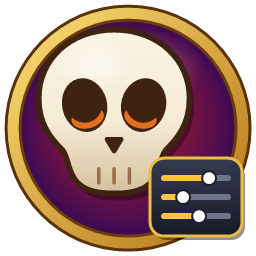
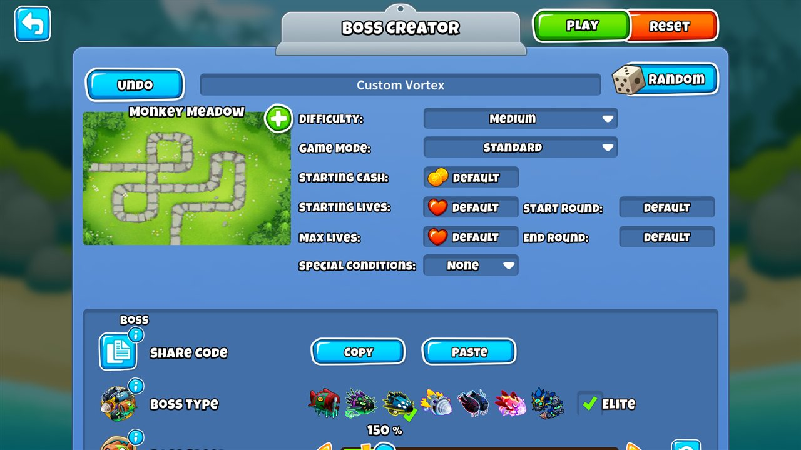
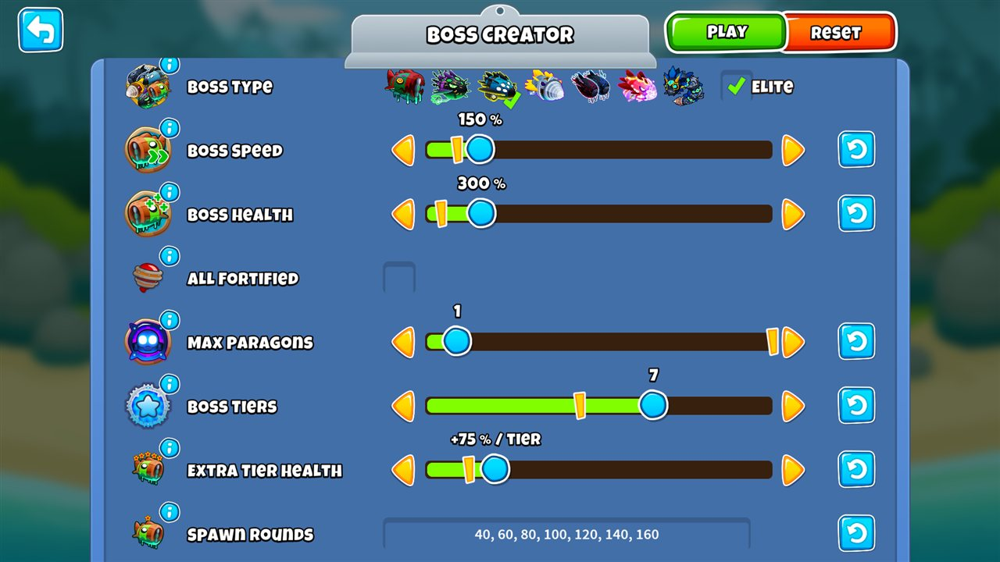
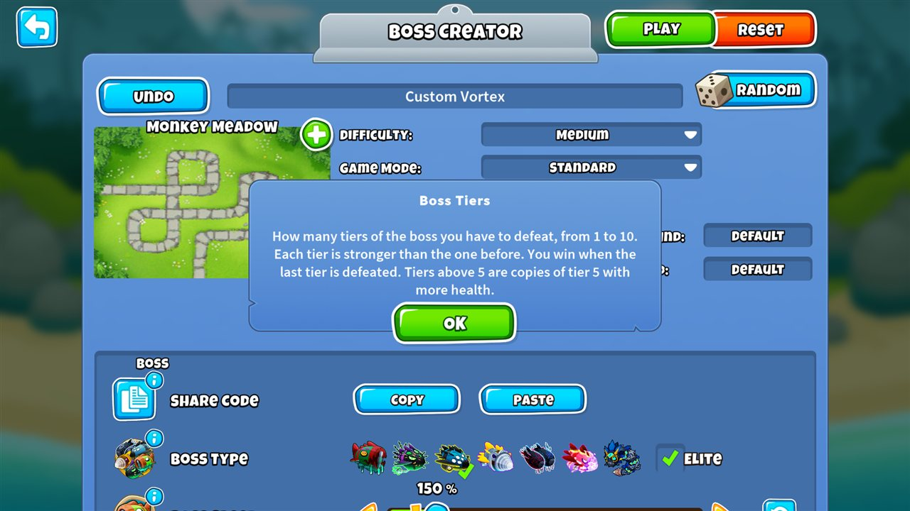
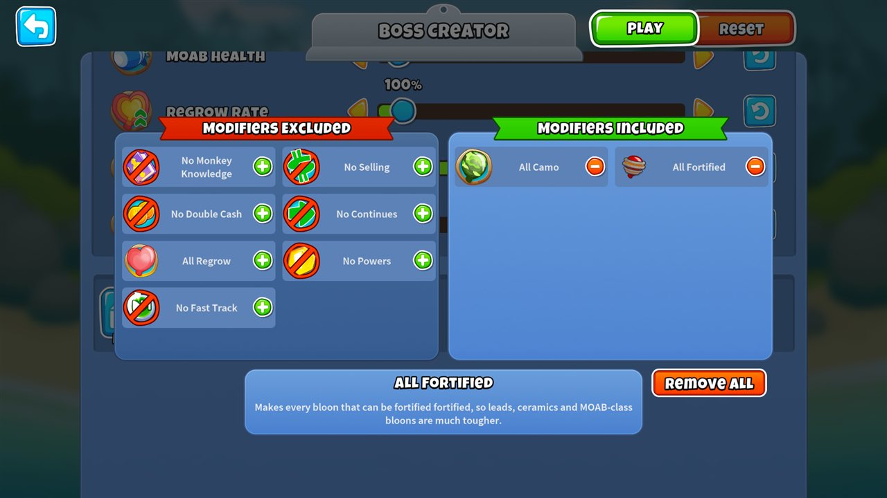
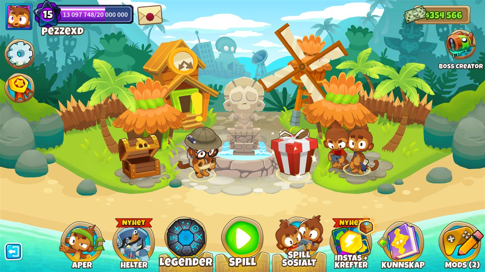
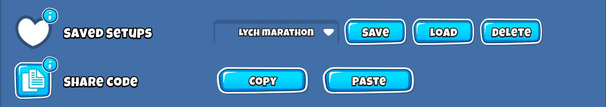
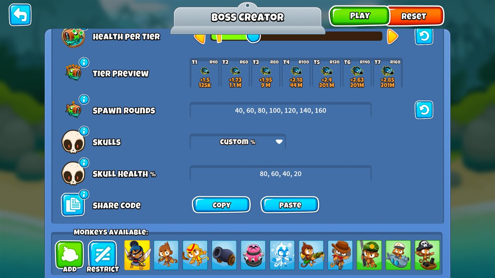

<h1 align="center">
<a href="https://github.com/pedersebastian/CustomBossChallenge/releases/latest/download/CustomBossChallenge.dll">
    
    
</a>
Custom Boss Challenge
</h1>

A Bloons TD 6 mod that adds a **Boss Creator** to the main menu: the game's own Challenge Editor, extended with
boss options. Make the boss faster or tankier, move or remove its skulls, play anywhere from 1 to 10 boss tiers on the
rounds you choose, and combine it with every rule the Challenge Editor already has. Ranked play, the weekly Boss
Event and your Boss Challenge records and saves are never affected.

**Website:** [pedersebastian.github.io/CustomBossChallenge](https://pedersebastian.github.io/CustomBossChallenge/),
where you can read a share code and see the whole setup without the game.



## Features

- **Boss Creator button** with the mod's logo on the main menu, just below the event buttons on the right.
- **The real Challenge Editor** with everything it normally has: map, difficulty, game mode, starting cash, lives
  and rounds, special conditions, tower restrictions, bloon sliders and modifiers.
- **All Fortified** among the editor's own modifiers, next to All Camo and All Regrow. The game has the rule but
  the vanilla editor doesn't offer it; it is only added in the Boss Creator.
- **Boss section** at the top of the editor:
  - Pick any boss (Bloonarius, Lych, Vortex, Dreadbloon, Phayze, Blastapopoulos, Diamondback) and toggle **Elite**.
  - **Boss Speed** and **Boss Health** sliders, using the game's own boss multipliers (the same ones Ninja Kiwi uses
    for weekly events such as "Vortex at 150% speed").
  - **Max Paragons**, the paragon limit events use, from 0 to Unlimited.
  - **Boss Tiers** from 1 to 10. Tiers above 5 are copies of tier 5 with +50 % health per tier. With fewer than 5
    tiers, beating the last one wins the game.
  - **Speed per Tier** and **Health per Tier**: make every tier faster and tougher than the one before it, on top of
    the game's own steps (or easier, below 0). The steps add up evenly: +100 % health makes tiers 2-5 ×2, ×3, ×4
    and ×5.
  - **Tier Preview**: a card per tier with the round it arrives on, its speed and its health, orange where it is
    harder than the normal game and blue where it is easier.
  - **Spawn Rounds** for every tier (default 40, 60, 80, 100, 120, then every 20 rounds), set evenly with the
    **First Boss Round** and **Rounds Between Tiers** sliders or typed one by one.
  - **Skulls**: keep the vanilla skulls, space any number evenly across the health bar, or place them at exact health
    percentages. Works for every boss and Elite tier (Lych uses its ethereal thresholds).
- **Free retries**: after losing, retry the last round or go back to the round the current tier arrived on, as often
  as you like and without Monkey Money. Your own Boss Challenge saves are never touched.
- **Continue after closing the game**: a custom game is kept after every round, so closing the game or a crash never
  loses a long run. Press **Boss Creator** on the main menu and choose **Continue** to pick it up on the round you left,
  free retries included. It is kept in `BloonsTD6/UserData/CustomBossChallenge/Continue.json`, separate from the
  game's own saves, and replaced when you win, restart or play a new custom game.
- **Translated** into every language BTD6 supports (English, Arabic, Chinese Simplified and Traditional, Danish,
  Dutch, Finnish, French, German, Italian, Japanese, Korean, Norwegian, Polish, Brazilian Portuguese, Russian,
  Spanish, Latin American Spanish, Swedish, Thai and Turkish), following the game's language setting.
- Every boss option has an **info button** (the "i" on its icon) that explains what it does.
- **Play** starts the custom boss game straight from the editor.
- **Share Code**: copy a whole setup as a short text code and paste codes others share.
- Your **last setup is remembered** between sessions.
- **Keyboard**: Ctrl+C and Ctrl+V copy and paste a share code, Ctrl+S saves the setup and Ctrl+Enter plays (Cmd on
  a Mac). Tab and Shift+Tab (or the up and down arrows) move a yellow frame through the Boss section: every boss, Elite,
  every slider, the text fields, the lists and the buttons, up to Play. Left and right change what has the frame
  (a slider step or the next option in a list), and Enter or Space press it, which also picks a boss. In a text field, Enter
  applies the value and moves on, and Esc cancels the edit instead of leaving the Boss Creator; while you type,
  Ctrl+C and Ctrl+V copy and paste text as usual.







## Usage

1. Click **Boss Creator** on the main menu (below the event buttons on the right).
2. Choose a boss, Elite or not, and set the boss options in the **Boss** section.
3. Set the map, difficulty, rules, towers and sliders like in any custom challenge.
4. Press **Play**. Pressing back saves the setup and returns to the main menu. After a game you return to the
   Boss Creator with the same setup. **Reset** also resets the boss options, back to a new setup with Bloonarius, and
   **Random** also randomizes them, always into a setup that can be played.



## Saved setups

The **Saved Setups** row keeps your favorite setups in the game, so you can switch between them without share codes:

- **Save** stores the whole setup, boss options and every Challenge Editor rule, under the challenge's name. Saving
  a name you already have asks before replacing it.
- Pick a setup in the list and press **Load** to play it again. Like Paste, it shows the setup and asks before it
  replaces your current one.
- **Delete** removes the picked setup, after asking.

Up to 50 setups are kept, in `BloonsTD6/UserData/CustomBossChallenge/SavedSetups.json`.



## Sharing setups

The **Share Code** row at the bottom of the Boss section turns the whole setup, boss options and every Challenge Editor
rule, into a short text code:

- **Copy** puts the code on the clipboard. Paste it into Discord, Reddit or a message.
- **Paste** reads a code from the clipboard, shows the challenge name, boss, tiers, map and difficulty, and asks
  before it replaces your current setup.

To look at a code without the game, paste it on the [website](https://pedersebastian.github.io/CustomBossChallenge/).
It shows the Tier Preview, skulls and rules like the Boss Creator does.

A code is only data: it can't run anything, and custom games are always unranked and never touch your records.
Codes are checked before they load, so values outside what the game can play are brought back into range.

Codes start with `CBC1:`, or `CBC2:` when they use Speed or Health per Tier so that older versions of the mod
ask for an update instead of loading them without those settings. They only contain what differs from a new
setup, so they are usually a few hundred characters. A new, unchanged setup gives a code like this one:

```
CBC1:q1bKV7KqrtVRSgZSSsWpqSlKVoamZiZGFmbGlrW1AA
```

And this is Vortex Elite with 7 tiers, +20 % speed and +50 % health per tier, so it is a `CBC2:` code:

```
CBC2:q1bKV7KqVnLKLy5WslIKyy8qSa1Q0lFyzcksSVWyKikqTdVRCslMLQLKmusoBRekpqYEpBaBRJSsjAx0lDxSE3NKMuBCpga1OkrJQBNrawE
```



## Boss options

| Option | Range | Default | Notes |
|---|---|---|---|
| Boss Type | 7 bosses | Bloonarius | Elite toggle next to it. |
| Boss Speed | 10–1000 % | 100 % | |
| Boss Health | 10–2000 % | 100 % | |
| Max Paragons | 0 – Unlimited | Unlimited | How many paragons can be placed. 0 allows none; all the way to the right has no limit. |
| Boss Tiers | 1–10 | 5 | The game is won when the last tier is defeated. |
| Speed per Tier | −10 to +50 % | 0 % | This share of a tier's normal speed is added for every tier after the first: +20 % makes tier 3 ×1.4. Capped at ×5. |
| Health per Tier | −10 to +200 % | 0 % | This share of a tier's normal health is added for every tier after the first: +100 % makes tier 5 ×5. Tiers above 5 already get +50 % each. |
| First Boss Round | 1–200 | 40 | Fills in Spawn Rounds together with Rounds Between Tiers. |
| Rounds Between Tiers | 1–50 | 20 | Fills in Spawn Rounds; 1 sends a new tier every round. |
| Spawn Rounds | comma separated rounds | 40, 60, 80, … | Missing rounds continue every 20 rounds; rounds always ascend. |
| Skulls | Vanilla / Evenly Spaced / Custom % | Vanilla | |
| Skull Count | 0–10 | 3 | Evenly Spaced only; 0 removes all skulls. |
| Skull Health % | comma separated % (1–99) | 75, 50, 25 | Custom only, e.g. `80, 60, 40, 20`. Use a point for decimals (`33.5`). The field shows the list as it is used: sorted, duplicates merged, invalid values dropped. |


Health is capped per tier like the game's own boss health limit, so very strong Elite tiers can end up with the same
health; the Tier Preview shows the capped values.

The game always ends 20 rounds after the last tier arrives (round 140 for the default 5 tiers, like the weekly
events), whatever end round the editor has, and a starting round after the last tier is reset. Otherwise the
difficulty's normal last round (e.g. 60 on medium) would end the game before the later tiers arrive.

Game modes without boss support (Deflation and Apopalypse) can't be played as a boss game.

## Safety guarantees

- Only games started from the Boss Creator are changed. Normal Boss Challenges, the weekly **Boss Event**, co-op and
  every other mode are left untouched.
- Custom games are **always unranked**, are **never saved by the game** (your Boss Challenge save is never
  overwritten; the mod keeps them in its own file to continue them) and never
  update Boss Challenge records, boss tier progress, badges or achievements. XP and Monkey Money are still earned.
- Your own Challenge Editor draft is never replaced by the boss setup.
- If a BTD6 update changes a part of the game these guards rely on, the Boss Creator stays closed and says what is
  missing, instead of starting games that could touch your records, achievements or Monkey Money. Update the mod.

## Upgrading from 1.x

Version 2 replaces the Mod Settings and the "Customize" button on the Boss Challenge screen with the Boss Creator.
Old settings are not carried over, and `BloonsTD6/Btd6ModHelper/Mod Settings/CustomBossChallenge.json` can be deleted.
The Boss Creator setup is stored in `BloonsTD6/UserData/CustomBossChallenge/LastSetup.json`.

## Known limitations

- **Co-op is turned off on purpose.** Custom boss games are single player only: in co-op every player runs the game
  on their own PC, so everyone would need the mod and the same setup, or the games would get out of sync. A co-op
  Boss Challenge is always a normal one, with the game's own bosses, even if you were in the Boss Creator before.
  This is not a bug.
- Tiers above 5 reuse the tier 5 look and abilities; the in-game tier display shows them like tier 5.

## Installation

### Mod Helper / Mod Browser (recommended)

1. Install [MelonLoader](https://melonwiki.xyz/) and [BTD6 Mod Helper](https://github.com/gurrenm3/BTD-Mod-Helper#readme).
2. Launch the game, open the **Mod Browser** from the Mod Helper menu, search for **Custom Boss Challenge** and
   download it.
3. Restart the game.

### Manual

1. Install MelonLoader and BTD6 Mod Helper.
2. Download `CustomBossChallenge.dll` from the
   [releases page](https://github.com/pedersebastian/CustomBossChallenge/releases).
3. Put the file in the `Mods` folder of your BTD6 installation and start the game.

## Reporting a bug

Open a [bug report](https://github.com/pedersebastian/CustomBossChallenge/issues/new?template=bug_report.yml). It
asks for:

- what you did, what you expected and what happened instead
- the mod version (shown in Mod Helper's mod list) and the game version
- the **Share Code** of your setup, if the bug happens in a boss game, so the setup can be loaded exactly
- the log file `MelonLoader/Latest.log` from your BTD6 folder, from a session where the bug happened. Older logs
  are kept in `MelonLoader/Logs`. Lines from this mod start with `[CustomBossChallenge]`; they say when a game
  is made unranked, when a share code is copied or loaded, and which values from a code or setup file were brought
  into range. Have a quick look before posting it: logs can contain folder paths from your PC.

## Building and testing

How to build the mod from source and run its automated tests is described in
[CONTRIBUTING.md](https://github.com/pedersebastian/CustomBossChallenge/blob/master/CONTRIBUTING.md) (the
**Contributing** tab on GitHub).

## AI disclaimer

This mod was made with the help of AI. Most of the code, tests, documentation and translations were written by
Claude (Anthropic) through Claude Code, guided, reviewed and play-tested by me. The translations are machine-made and
may sound unnatural in some languages; corrections are welcome as a
[translation fix](https://github.com/pedersebastian/CustomBossChallenge/issues/new?template=translation.yml) or a
pull request (see [Translations](https://github.com/pedersebastian/CustomBossChallenge/blob/master/CONTRIBUTING.md#translations)).

## License

[MIT](LICENSE)

[](https://github.com/gurrenm3/BTD-Mod-Helper#readme)
